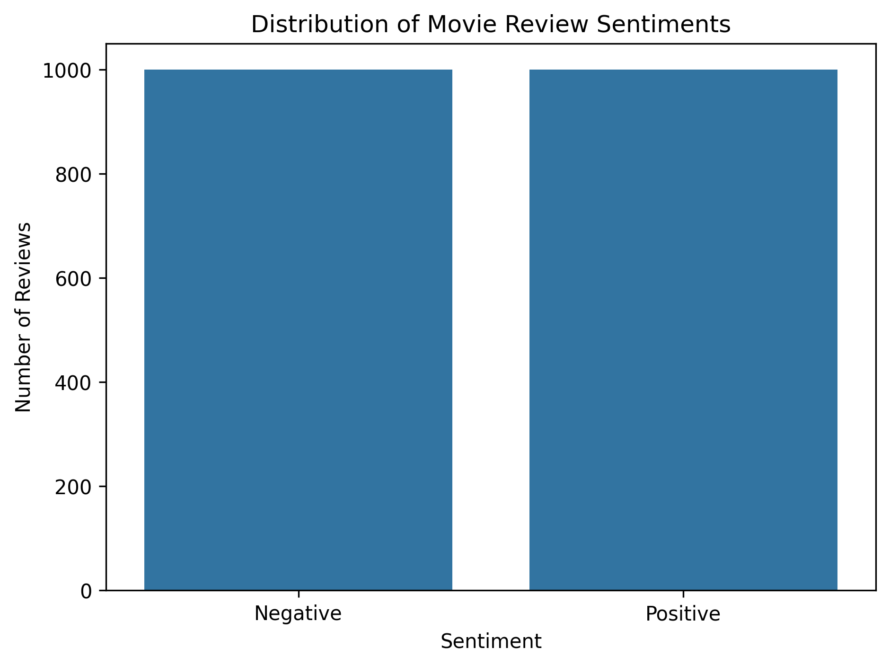
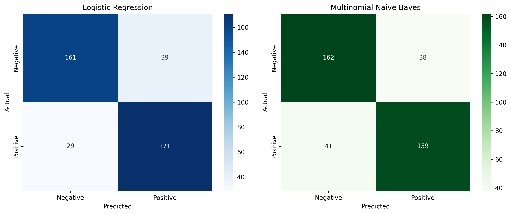
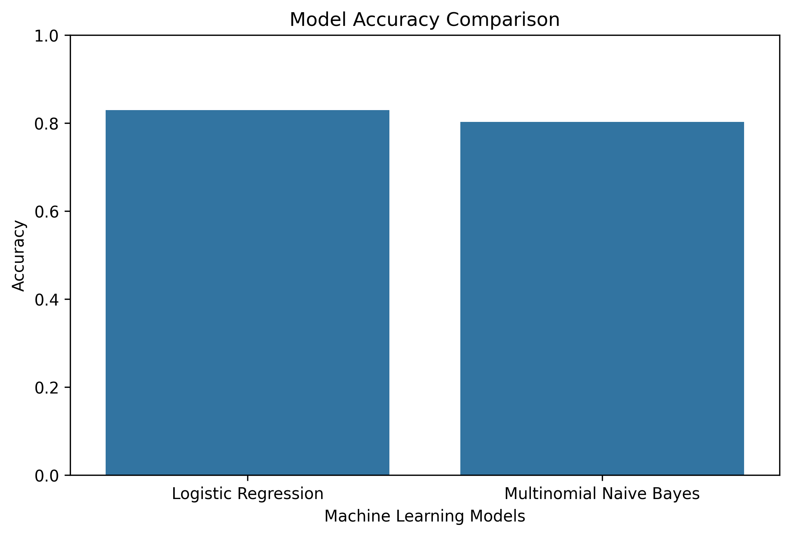

# Movie Review Sentiment Analysis using Machine Learning

## 1. Project Overview

This project focuses on developing a Machine Learning model that can automatically classify movie reviews as Positive or Negative using Natural Language Processing (NLP).

The project uses TF-IDF vectorization to convert text into numerical features and compares two Machine Learning algorithms: Logistic Regression and Multinomial Naive Bayes.

The main objective is to identify the sentiment expressed in a movie review and evaluate the performance of both models.

## 2. Project Objectives

- Understand and analyze text-based data.
- Perform text preprocessing and cleaning.
- Convert text into numerical features using TF-IDF.
- Train Logistic Regression and Multinomial Naive Bayes models.
- Compare model performance using evaluation metrics.
- Predict sentiment for new movie reviews.
- Save the trained Machine Learning pipeline for future predictions.

## 3. Dataset Information

**Dataset:** NLTK Movie Reviews Dataset

The dataset contains 2,000 movie reviews classified into two sentiment categories.

| Dataset Information | Details |
|---|---|
| Total Reviews | 2,000 |
| Positive Reviews | 1,000 |
| Negative Reviews | 1,000 |
| Missing Values | 0 |
| Duplicate Records | 0 |
| Training Data | 1,600 |
| Testing Data | 400 |

The dataset was downloaded using the NLTK Movie Reviews corpus.

## 4. Technologies and Libraries Used

- Python
- Google Colab
- Pandas
- NumPy
- NLTK
- Scikit-learn
- Matplotlib
- Seaborn
- Joblib

## 5. Data Preprocessing

The following preprocessing steps were performed:

1. Loaded the movie reviews dataset.
2. Checked the dataset structure and information.
3. Identified missing values and duplicate records.
4. Converted sentiment labels into numerical values:
   - Negative = 0
   - Positive = 1
5. Divided the dataset into 80% training data and 20% testing data.
6. Applied TF-IDF vectorization to convert text into numerical features.
7. Used English stop-word removal and unigram/bigram features.

## 6. Machine Learning Algorithms

Two Machine Learning algorithms were implemented.

### A. Logistic Regression

Logistic Regression is a supervised Machine Learning algorithm used for classification. It predicts whether a movie review is Positive or Negative.

### B. Multinomial Naive Bayes

Multinomial Naive Bayes is a probabilistic classification algorithm commonly used for text classification. It calculates the probability of a review belonging to a particular sentiment category.

## 7. Model Evaluation

Both models were evaluated using four performance metrics:

- Accuracy
- Precision
- Recall
- F1 Score

### Performance Comparison

| Model | Accuracy | Precision | Recall | F1 Score |
|---|---:|---:|---:|---:|
| Logistic Regression | 83.00% | 81.43% | 85.50% | 83.41% |
| Multinomial Naive Bayes | 80.25% | 80.71% | 79.50% | 80.10% |

### Best Performing Model

Logistic Regression achieved better overall performance compared to Multinomial Naive Bayes.

Its performance was:

- Accuracy: 83.00%
- Precision: 81.43%
- Recall: 85.50%
- F1 Score: 83.41%

Therefore, Logistic Regression was selected as the best-performing model and saved as a complete TF-IDF and classification pipeline.

## 8. Data Visualizations

### A. Sentiment Distribution

This graph displays the distribution of positive and negative movie reviews in the dataset.

### B. Confusion Matrices

Confusion matrices show the correctly and incorrectly classified reviews for both Machine Learning models.

### C. Model Accuracy Comparison

This graph compares the accuracy of Logistic Regression and Multinomial Naive Bayes.

## 9. Sample Predictions

The trained model was tested using manually written movie reviews.

Example:

| Movie
